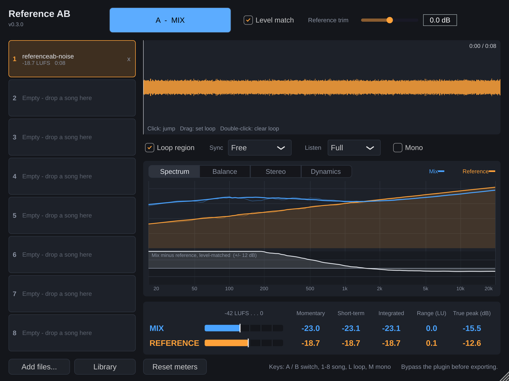
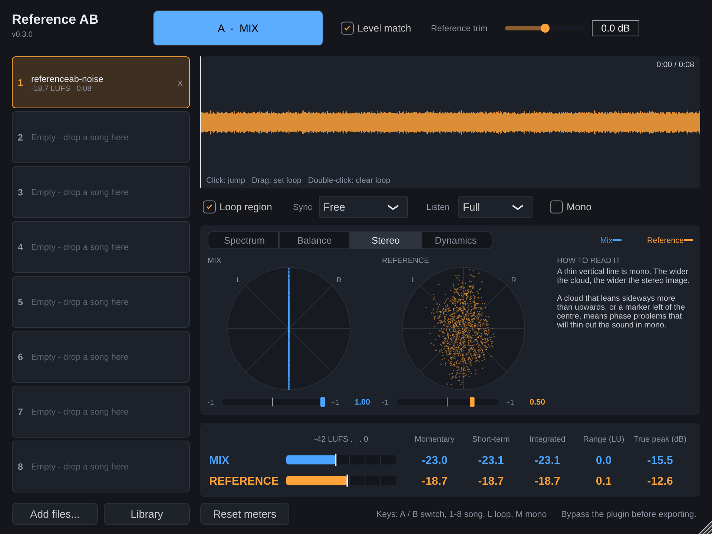

# Reference AB

VST3 plugin za poređenje miksa sa referentnim pesmama, za Windows i macOS. Pravljen za Bitwig Studio, po uzoru na Metric AB i REFERENCE.





## Šta radi (verzija 0.3)

- **Do 8 referentnih pesama** (WAV, AIFF, FLAC, MP3, OGG). Prevuci fajlove na plugin ili klikni *Add files...*. Pesme se pamte u projektu.
- **A/B dugme** prebacuje između tvog miksa (A) i reference (B), bez klika u zvuku.
- **Level match** automatski izjednačava glasnoću reference sa tvojim miksom (po LUFS-u), da glasnija pesma ne bi zvučala „bolje“. Kad je označen loop region, meri se glasnoća baš tog dela, a ne cele pesme. *Reference trim* je ručna korekcija.
- **Library:** svaka pesma koju ubaciš pamti se u biblioteci koja važi za sve projekte. Dugme *Library* je učitava jednim klikom.
- **Loop region:** prevuci mišem preko talasnog oblika da označiš deo koji se ponavlja. Klik skače na poziciju, dupli klik briše region.
- **Sync:** *Free* (referenca svira stalno), *Transport* (svira samo kad Bitwig svira), *Timeline* (prati poziciju projekta).
- **Listen:** slušanje samo niskih (ispod 250 Hz), srednjih ili visokih (iznad 4 kHz) frekvencija, plus **Mono** provera. Važi i za miks i za referencu.
- **Spectrum:** prosečan spektar miksa i reference jedan preko drugog (debele linije), uz spektar uživo (tanke linije), i ispod kriva razlike (miks minus referenca, sa izjednačenom glasnoćom). Sve iznad linije znači da tvoj miks tu ima više.
- **Balance:** razlika po opsezima (Sub, Bass, Mids, Presence, Air) u dB, stereo širina po opsezima, korelacija, i kratak rezime rečima šta se razlikuje.
- **Stereo:** goniometar (vektorskop) i korelacija za miks i referencu, jedan pored drugog.
- **Dynamics:** glasnoća u poslednjih 60 sekundi, PSR (koliko je zvuk „udaran“ u ovom trenutku) i PLR (koliko je cela pesma kompresovana).
- **Prozor** se može povećati povlačenjem donjeg desnog ugla; veličina se pamti u projektu.
- **Tasteri** (kad je prozor plugina aktivan): `A` miks, `B` referenca, `1`-`8` izbor pesme, `L` loop, `M` mono.
- **Merači:** Momentary, Short-term i Integrated LUFS, Loudness Range i True Peak za miks i referencu (ITU-R BS.1770 / EBU R128).

## Kako se koristi

1. Stavi plugin kao **poslednji** na master kanalu.
2. Ubaci referentne pesme i pusti svoj projekat nekoliko sekundi, da plugin izmeri glasnoću miksa.
   Analiza je prosek poslednjih nekoliko sekundi zvuka, zato poredi iste delove pesme (refren sa refrenom). *Reset meters* briše sva merenja.
3. Prebacuj A/B. U Bitwigu možeš da mapiraš parametar *A/B (Reference)* na taster ili kontroler.
4. **Pre exporta isključi (bypass) ili ukloni plugin**, da referenca ili filteri ne bi završili u pesmi.

## Preuzimanje i instalacija

Poslednja verzija sa instalerom za Windows i Mac nalazi se na stranici **[Releases](../../releases/latest)**.

- Windows: preuzmi i pokreni `ReferenceAB-...-Windows-Setup.exe`.
- Mac: preuzmi `ReferenceAB-...-macOS.pkg`, desni klik, pa *Open*.

Instaleri nisu potpisani, pa sistem prikaže upozorenje pri prvom pokretanju. Detalji i ručna instalacija su u [docs/INSTALL.txt](docs/INSTALL.txt).

## Plan

- [x] v0.1: reference, A/B, level match, loop, sync, LUFS merači
- [x] v0.2: spektar, tonalni balans, dinamika, stereo širina, rezime razlika
- [x] v0.3: level match po loop delu, biblioteka referenci, goniometar, prozor promenljive veličine, tasteri, instaleri

## Za razvoj

Potrebni su CMake 3.22+ i C++17 kompajler. JUCE se preuzima automatski.

```
cmake -S . -B build -DCMAKE_BUILD_TYPE=Release
cmake --build build --config Release
ctest --test-dir build -C Release --output-on-failure
```

Plugin koristi [JUCE](https://juce.com) (besplatan za ličnu upotrebu; za prodaju proveriti uslove licence).
